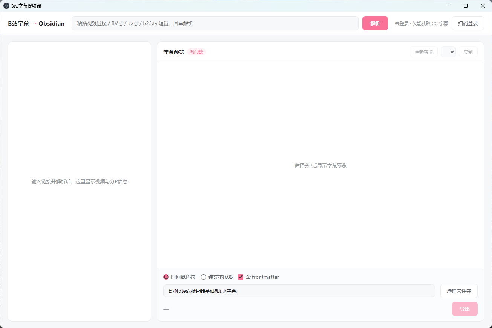

# bili-subtitle-to-obsidian

提取 B 站视频字幕，一键导出为 Obsidian 可直接识别的 Markdown 笔记。

粘贴链接 → 选分P → 导出，笔记里带可点击跳回视频的时间戳。



## 为什么做这个

在 B 站学习时，字幕是最有价值的内容载体，但复制到笔记软件非常麻烦：字幕面板不能整段复制，时间轴和正文混在一起，分P视频更是要一集一集手动处理。

这个工具把整条链路压缩成三步：粘贴链接、选分P、点导出。导出的 Markdown 带 frontmatter 元数据，Obsidian 里可以直接检索、双链、喂给 AI 总结。

## 功能

### 视频解析

- 支持 BV 号、av 号、完整链接、`b23.tv` 短链
- 自动识别链接里的 `?p=` 分P参数并定位到对应分P
- 左侧展示封面、标题、UP主、简介、分P列表

### 字幕获取

- 支持 AI 字幕与 UP 主上传的 CC 字幕，多语言可切换下拉
- 扫码登录（B 站手机客户端）或手动填写 Cookie，登录态保存在本地
- **自动校验 + 重试**：B 站接口偶发返回其他视频的字幕，程序会自动重取最多 8 轮，并按「时长覆盖率 / 文字密度 / 标题关键词命中率」三重校验
- 校验不通过时在标题栏给出橙色提示，可手动点「重新获取」

### 导出

- 时间戳模式：每句一行，时间戳可点击跳转到视频对应位置
- 纯文本模式：按标点合并成自然段，适合直接给 AI 总结
- 可选 YAML frontmatter（标题 / UP主 / BV号 / 原链接 / 分P / 时长 / 导出时间 / tags）
- 文件名自动清洗非法字符，重名自动追加序号，不覆盖已有笔记
- 记住上次使用的导出目录与格式

## 下载与安装

### 方式一：下载可执行版本（推荐给普通用户）

1. 打开本仓库的 [Releases](../../releases) 页面
2. 下载 `BiliSubtitleToObsidian-v1.0.0-win-x64.zip`
3. 解压到任意目录，双击 `BiliSubtitleToObsidian.exe`

免安装、无需 Node.js 环境。首次运行 Windows 可能弹出 SmartScreen 提示，选择「更多信息 → 仍要运行」即可（本项目未做代码签名）。

### 方式二：从源码运行

环境要求：Node.js 18 及以上。

```bash
npm install
npm start
```

国内网络如果 Electron 下载缓慢，先设置镜像再安装：

```powershell
# Windows PowerShell
$env:ELECTRON_MIRROR="https://npmmirror.com/mirrors/electron/"
npm install
```

```bash
# macOS / Linux
export ELECTRON_MIRROR="https://npmmirror.com/mirrors/electron/"
npm install
```

## 使用步骤

1. 把视频链接粘贴到顶部地址栏，点「解析」（回车同样可以）
2. 首次使用点右上角「扫码登录」，用 B 站手机客户端扫码确认；也可以点「手动填写 Cookie」粘贴 SESSDATA
3. 在左侧分P列表中选中要导出的一集，右侧会显示字幕预览
4. 确认导出格式（时间戳 / 纯文本）与 frontmatter 选项
5. 选择保存目录（建议指向 Obsidian 仓库内的某个文件夹），点「导出」

导出成功后会提示文件路径，可直接点「打开目录」查看。

## 导出效果

```markdown
---
title: "Java 并发编程详解"
up主: "某某老师"
bvid: BV1xx411c7mD
url: https://www.bilibili.com/video/BV1xx411c7mD?p=2
分P: "P2 线程池原理"
时长: "08:11"
导出时间: "2026-11-22 14:30"
tags: [bilibili, 字幕]
---

# Java 并发编程详解 · P2 线程池原理

> 来源：[BV1xx411c7mD](https://www.bilibili.com/video/BV1xx411c7mD?p=2) ｜ UP主：某某老师 ｜ 时长：08:11

[00:00](https://www.bilibili.com/video/BV1xx411c7mD?p=2&t=0) 今天我们来讲线程池的七个参数
[00:06](https://www.bilibili.com/video/BV1xx411c7mD?p=2&t=6) 第一个是核心线程数
```

在 Obsidian 中点击时间戳会打开浏览器并定位到对应播放位置。

## 常见问题

**为什么必须登录？**
B 站字幕接口只有在携带登录态时才会返回 AI 字幕列表，未登录大多数视频拿不到字幕。

**提示「可能不是本视频的字幕」怎么办？**
这是 B 站接口的线上问题：同一个视频连续请求可能返回空数据或其他视频的字幕。程序已自动重试 8 轮，仍失败时点「重新获取」即可，通常 1~2 次就能拿到正确内容。

**标题很短的视频也提示异常？**
标题关键词太少时（例如只有「P1 课程介绍」），关键词命中率校验可能误判。这不影响预览和导出，忽略提示即可。

**提示「该视频没有可用字幕」？**
说明 B 站确实没有为该视频生成 AI 字幕，也没有 CC 字幕。本工具不做语音转写。

**时间戳点了没反应？**
时间戳是普通 Markdown 链接，点击后由系统默认浏览器打开，请确认已设置默认浏览器。

## 版本说明

### v1.0.0（2026-11-22）

首个可用版本：

- 视频解析：BV / av / 完整链接 / b23.tv 短链
- 分P列表选择，单分P导出
- 扫码登录 + 手动 Cookie 兜底，登录态本地持久化
- AI 字幕 / CC 字幕获取，多语言切换
- 字幕自动校验与 8 轮重试
- Markdown 导出：时间戳 / 纯文本两种格式，可选 frontmatter
- 文件重名保护、目录与格式记忆

## 技术实现

- **主进程**：所有 B 站请求、Cookie 持久化、二维码生成、Markdown 拼接与写盘
- **渲染进程**：原生 HTML / CSS / ES Module，无构建步骤
- **接口**：
  - `x/web-interface/view` — 视频信息与分P
  - `x/player/v2` — 字幕列表与字幕地址
  - `x/passport-login/web/qrcode/*` — 扫码登录
  - `x/web-interface/nav` — 登录状态校验
- **安全**：`contextIsolation` 开启，`nodeIntegration` 关闭，仅通过 preload 暴露必要 IPC

## 项目结构

```
src/
  main/
    index.js       窗口、IPC、写盘
    bilibili.js    B 站接口与字幕校验
    markdown.js    Markdown 生成与文件名清洗
    store.js       本地配置持久化
  preload.js       IPC 桥接
  renderer/
    index.html     界面结构
    styles.css     样式
    app.js         交互逻辑
docs/
  screenshot.png   界面截图
```

## 本地打包

```bash
npm run package:win
```

产物位于 `release/BiliSubtitleToObsidian-win32-x64/`，压缩该目录即可作为 Release 附件发布。

## 免责声明

- 本项目为非官方工具，与哔哩哔哩无任何关联
- 仅供个人学习与研究使用，字幕版权归视频作者与 UP 主所有
- 请勿将导出的字幕用于二次传播、转载或商业用途
- 接口可能随时变更导致功能失效，使用前请遵守哔哩哔哩用户协议

## License

[MIT](LICENSE)
